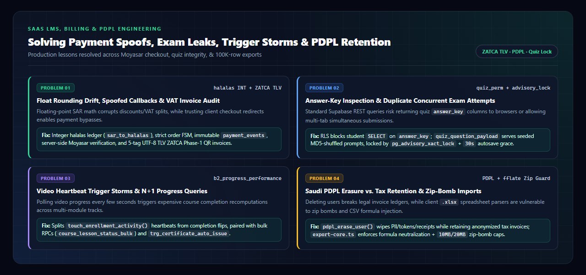
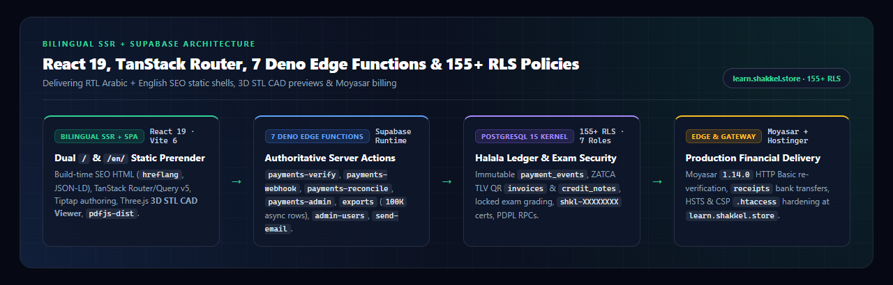
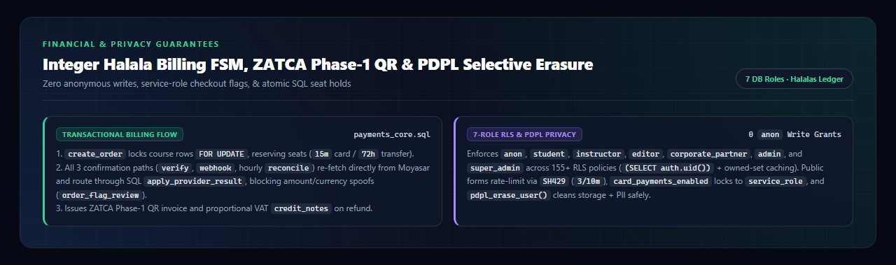
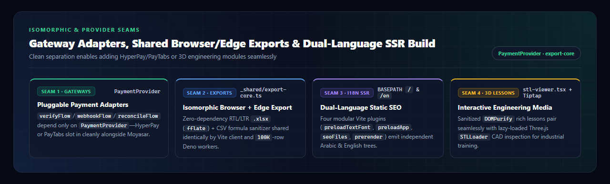

# Shakkel Corporate LMS (`learn.shakkel.store`)

**Bilingual Arabic RTL / English SSR Learning Platform Featuring an Integer-Halala & ZATCA Phase-1 QR Billing Ledger, Anti-Cheating Assessment Engine, Three.js 3D STL CAD Inspection, and Saudi PDPL Compliance**

[Visit Live LMS (`learn.shakkel.store`)](https://learn.shakkel.store/) &nbsp;|&nbsp; [Problems Solved](#solving-production-lms-billing--pdpl-challenges) &nbsp;|&nbsp; [Architecture](#bilingual-ssr--supabase-edge-architecture) &nbsp;|&nbsp; [Billing & PDPL](#financial-security--saudi-pdpl-guarantees) &nbsp;|&nbsp; [Extensibility](#isomorphic--provider-extensibility-seams)

---

| Platform Layer | Verified Production Stack | Engineering Guarantee |
| :--- | :--- | :--- |
| **Frontend & SEO Build** | `React 19.2.8`, `TS 5.9.3`, `Vite 6.4.5`, `TanStack Router/Query v5` | Static build-time Arabic `/` + English `/en/` SEO prerendering + `hreflang` |
| **Interactive Media** | `Tiptap 3.32.0`, `DOMPurify 3.4.17`, **`Three.js 0.186.1` (`STLLoader`)**, `pdfjs-dist` | Sanitized course lessons + lazy WebGL 3D manufacturing CAD viewer inside modules |
| **Edge Functions (Deno)** | `7` Functions (`payments-verify/webhook/reconcile/admin`, `exports`, `admin-users`, `send-email`) | Authoritative Moyasar `1.14.0` verification + async `100K`-row streaming exports |
| **Database Kernel** | `Supabase PostgreSQL 15` (**`155+` RLS policies**, **7 DB roles**, `SECURITY DEFINER`) | `anon` holds zero write grants; `(SELECT auth.uid())` & owned-set cached policies |
| **Financial & Tax Compliance** | `halalas` integer ledger, `payment_events` immutable log, **`zatca_tlv`** | Unidirectional FSM triggers + 5-tag UTF-8 TLV ZATCA Phase-1 QR invoices & credit notes |
| **Privacy Governance** | Saudi PDPL RPCs (`my_data_export()`, `pdpl_erase_user()`) | Full JSON export (secrets stripped) + anonymized erasure preserving tax/cert records |

---

## Solving Production LMS, Billing & PDPL Challenges

Operating a live Saudi commercial training platform (`learn.shakkel.store`) for individual learners and corporate teams introduced four deep engineering problems beyond typical course players: floating-point checkout drift and spoofable 3DS redirects, student browser inspection of exam answers or double-tab submissions, SQL trigger storms from frequent video playback heartbeats, and reconciling Saudi PDPL user erasure requests against mandatory VAT invoice and credential retention laws.

  

### How Every Core Failure Mode Is Prevented

1. **Integer-Halala Billing & Server-Verified Checkout (`payments_core.sql`, `_shared/payments/*`):** Stores prices, discounts, VAT (`vat_halalas`, `vat_rate_bp`), and refunds purely in integer halalas (`sar_to_halalas`, `money_div_half_up`). Trigger `guard_order_update_trg` blocks altering settled totals or currencies and enforces a one-way status FSM (`pending -> paid|failed|cancelled`; `paid -> refunded_partial|refunded_full`). Every payment signal (`payments-verify`, `payments-webhook` via `safeEqual`, and hourly `payments-reconcile`) re-queries **Moyasar (`1.14.0`)** directly via HTTP Basic and settles atomically through SQL `apply_provider_result`, issuing 5-tag UTF-8 TLV **ZATCA Phase-1 QR** `invoices` and proportional `credit_notes`.
2. **Zero-Exposure Exam Engine (`quiz_engine.sql`):** Supports 10 question types (from MCQ & matching to timed essays and upload assignments) while denying students `SELECT` access on `quiz_questions.answer_key`. `quiz_question_payload` returns stripped questions with deterministically seeded MD5 permutations (`quiz_perm`), prevents concurrent sessions via `quiz_attempts_one_active_uq` + `pg_advisory_xact_lock`, autosaves answers (`30s` grace, `allow_back=false` freeze), and closes overtime attempts automatically.
3. **Heartbeat-Split Progress & Set-Based Unlocking (`b2_progress_performance.sql`):** Decouples high-frequency video watch heartbeats (`touch_enrollment_activity()`) from completion cascades, batches progress over set-based RPCs (`course_lesson_status_bulk`, `module_unlock_states`), and triggers automatic `shkl-XXXXXXXX` certificates (`trg_certificate_auto_issue`).
4. **Zip-Bomb & XSS Immunity (`export-core.ts`, `sanitize.ts`):** Browser `.xlsx` imports pre-scan ZIP headers against `10 MB` file, `100` entry, `20 MB` decompressed, and `5,000` row limits (`fflate`), while lesson HTML passes strict `DOMPurify` tag/attribute sanitization.

---

## Bilingual SSR & Supabase Edge Architecture

  

- **Dual Static Prerender + 3D Lesson Media (`vite.config.ts`, `src/prerender/entry.ts`):** Compiles completely independent Arabic (`/` RTL) and English (`/en/` LTR) SEO HTML shells with `<noscript>` fallbacks and Hostinger `.htaccess` rewrites (`_app.html`, `en/_app.html`), paired inside lessons with lazy-loaded **Three.js 3D STL CAD geometry previewers** (`stl-viewer.tsx`) for industrial engineering coursework.
- **Public Verification & Staff Compensation (`admin-users`, `verify_certificate`):** Public certificate checks expose minimal non-PII verification metadata while staff account lifecycle actions execute through compensating Deno Edge handlers.

---

## Financial Security & Saudi PDPL Guarantees

  

- **Strict 7-Role PostgreSQL Matrix (`anon -> student -> instructor -> editor -> corporate_partner -> admin -> super_admin`):** `b1_security_integrity.sql` stripped all write grants from `anon`; public lead/contact endpoints route strictly through SQL rate-limited functions (`SH429` at `3/10m`, `10/day`, `100/hr`), bank receipt uploads bind by regex to `users/<uid>/orders/<order_id>/...` in private storage reviewed by `super_admin`, and `guard_card_payments_flag` locks payment toggles solely to `service_role`.
- **PDPL Right of Access & Statutory Erasure (`pdpl_my_data.sql`):** `my_data_export()` compiles complete user activity JSON (stripping password hashes and internal staff notes), whereas `pdpl_erase_user()` purges PII, IPs, session tokens, messages, waitlist emails, and Storage objects while legally preserving anonymized invoices, payments, grades, `shkl-XXXXXXXX` certificates, and `audit_logs` (`account_is_staff` blocks staff self-wipe).
- **Transport Hardening (`public/.htaccess`):** Enforces 1-year `HSTS`, `X-Frame-Options: DENY`, `nosniff`, restrictive CSP-Report-Only allowlists, and strict `404` responses on missing asset probes.

---

## Isomorphic & Provider Extensibility Seams

  

1. **Swappable Gateway Adapters (`PaymentProvider`):** Decouples verification, webhooks, hourly reconciliation, and partial/full refunds from vendor schemas—adding HyperPay or PayTabs requires only implementing one adapter.
2. **Isomorphic Export Core (`_shared/export-core.ts`):** Zero-dependency `.xlsx` (`fflate`) + CSV formula-safe engine (`safeCell`, Riyadh timezone formatting) imported identically in browser bundles and `100,000`-row async Edge workers (`EdgeRuntime.waitUntil`).
3. **Four-Plugin Vite SSR Pipeline (`preloadTextFont`, `preloadApp`, `seoFiles`, `prerender`):** Dynamically drives Arabic and English localized static builds from `BASEPATH`.

---

> [!NOTE]
> Live commercial codebase remains proprietary; this repository preserves verified system architecture documentation alongside the public production platform.

[Visit Live Shakkel Learning Hub](https://learn.shakkel.store/) &nbsp;|&nbsp; [Shakkel Industrial](https://shakkel.store/) &nbsp;|&nbsp; [Portfolio](https://abdulqader-alshihabi.github.io/) &nbsp;|&nbsp; [LinkedIn](https://www.linkedin.com/in/abdulqader-alshihabi-859b19260/) &nbsp;|&nbsp; Built by **Abdulqader Alshihabi**

